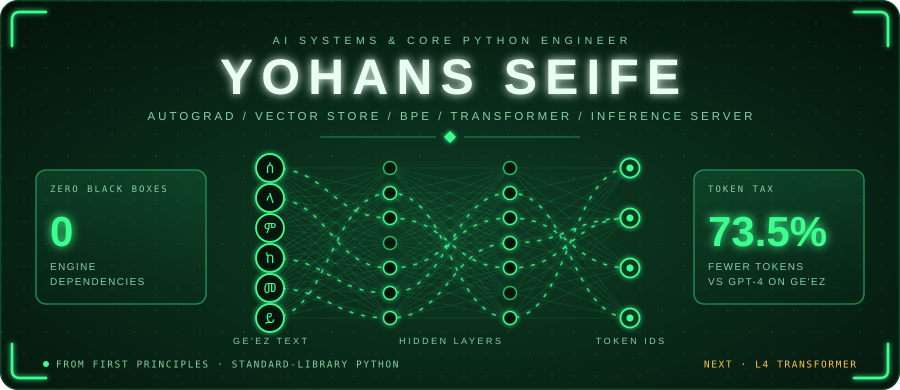
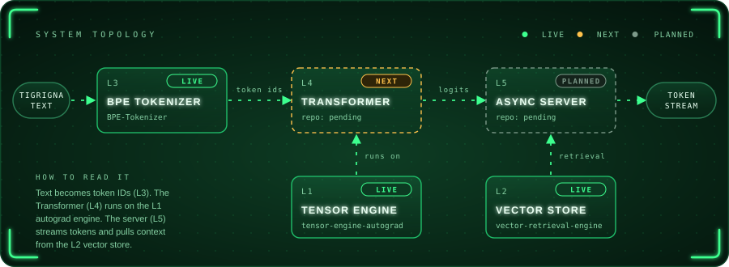
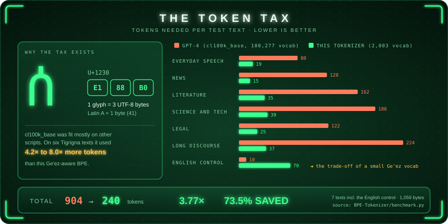

<div align="center">



<br>


-8957e5?style=for-the-badge)

[Topology](#-system-topology) · [Stack](#-the-vertical-stack) · [Decisions](#-decision-log) · [Foundations](#-foundations-archive) · [Invariants](#-global-invariants) · [Toolbox](#-toolbox) · [Contact](#-contact)

</div>

> **Next up:** L4 · Transformer, built on L1 and fed by L3.

---

## 🧬 System Topology



<details>
<summary>Plain-text version </summary>

```
                                 ┌─────────────────────────────┐
 Tigrigna text ─────────────────►│ L3  BPE Tokenizer    [LIVE] │
                                 └──────────────┬──────────────┘
                                                │ token ids
                                                ▼
 ┌───────────────────────────┐   ┌─────────────────────────────┐
 │ L1  Tensor + Autograd     │──►│ L4  Transformer      [NEXT] │
 │                    [LIVE] │   └──────────────┬──────────────┘
 └───────────────────────────┘                  │ logits
                                                ▼
 ┌───────────────────────────┐   ┌─────────────────────────────┐
 │ L2  MMap Vector Store     │──►│ L5  Async Server  [PLANNED] │ ──► stream
 │                    [LIVE] │   └─────────────────────────────┘
 └───────────────────────────┘
```

<sub>🟢 `[LIVE]` · 🟠 `[NEXT]` · 🔵 `[IN PROGRESS]` · ⚪ `[PLANNED]` · ⚫ `[ARCHIVED]`  |  L1 ──► L4: tensors and gradients  ·  L2 ──► L5: retrieval</sub>

</details>

---

## 🧱 The Vertical Stack

### L1 · [`tensor-engine-autograd`](https://github.com/johnseife2602-source/tensor-engine-autograd) 🟢 `[LIVE]`
- **Constraint:** stdlib only · one flat 1-D buffer + row-major strides · no NumPy, no PyTorch
- **Problem & benchmark:** Reverse-mode autograd with broadcasting/unbroadcasting and matmul gradients. XOR on `MLP[2,16,16,1]`: MSE **0.5274 → 0.0000** in 200 epochs; 8 tests, including a finite-difference gradient check.
- **Linkage:** ▲ gradient engine under L4 · ▼ root layer

### L2 · [`vector-retrieval-engine`](https://github.com/johnseife2602-source/vector-retrieval-engine) 🟢 `[LIVE]`
- **Constraint:** `struct` · `mmap` · `heapq` · `json` · no NumPy, no FAISS
- **Problem & benchmark:** Top-K search past the RAM limit, `O(N log K)` time and `O(K)` search memory. On 10,000 × 128-d vectors the `mmap` engine returns rankings identical to the in-memory engine with no vectors resident in RAM, at ~2.6× the latency (2.42 s vs 0.93 s average). 14 tests.
- **Linkage:** ▲ retrieval backend for L5 · ▼ root layer

### L3 · [`BPE-Tokenizer`](https://github.com/johnseife2602-source/BPE-Tokenizer) 🟢 `[LIVE]` ⭐ Featured

> [!IMPORTANT]
> **The Token Tax.** An LLM never sees strings, only token IDs. Frontier tokenizers (`cl100k_base`) treat Ethiopic script (Ge'ez / Tigrigna, `U+1200–U+137F`) as an afterthought: 3-byte characters fragment into 4×–8× more tokens, so native speakers pay for it in context window and in cost.
>
> **Result:** 240 vs 904 tokens on the test set (3.77×, 73.5 % saved) and 8.00× on a news sentence; worse on English (70 vs 10 tokens), the trade-off of a 2,003-token Ge'ez vocabulary.
>
> **Constraint:** core engine uses `re` · `pathlib` · `io` only (`tiktoken` is optional, for the GPT-4 baseline) · native punctuation `፡` `።` `፣`
> **Linkage:** ▲ none (reads raw UTF-8) · ▼ token IDs feed L4



### L4 · `generative-transformer-scratch` 🟠 `[NEXT]`
- **Constraint:** stdlib only · every op runs on L1
- **Problem & benchmark:** Autoregressive generation over L3 token IDs. Benchmark: pending.
- **Linkage:** ▲ served by L5 · ▼ L1 (autograd), L3 (token IDs)

### L5 · `async-inference-server` ⚪ `[PLANNED]`
- **Constraint:** stdlib only · `asyncio`
- **Problem & benchmark:** Concurrent token streaming of my own L4 model, tokenized by L3 and backed by L2 retrieval. Benchmark: pending.
- **Linkage:** ▼ L4 (model), L3 (tokenizer), L2 (retrieval)

---

## 📜 Decision Log

<!-- Append new pivots below the last one (newest last). Copy the Pivot 01 block. -->

### Pivot 01 · Why tokenization was prioritized over serving
- **Context:** The roadmap's next step was the async inference server (then Project 06). A server can only stream tokens it can produce, and `from_pretrained()` would put a black-box tokenizer under a stack built on zero black boxes.
- **Observation:** Ethiopic characters are 3 bytes in UTF-8, and `cl100k_base` splits them into 4×–8× more tokens, which shrinks effective context and multiplies per-request cost.
- **Decision:** Build the tokenizer first (now Project 06 → L3), then the Transformer (Project 07) and the server (Project 08). Representation precedes generation.
- **Outcome:** GPT-4 needed 3.77× the tokens overall (904 vs 240, a 73.5 % saving) on a 7-text test set that includes an English control, and 8.00× on a news sentence.

---

## 📦 Foundations Archive

<details>
<summary><b>Projects 1–3 · GUI, desktop state, concurrency</b> (third-party libraries allowed here by design)</summary>

<br>

| # | Project | Stack | Result | Lesson |
|:-:|:--|:--|:--|:--|
| 01 | [`weather-app-pyqt5`](https://github.com/johnseife2602-source/weather-app-pyqt5) | PyQt5 · OpenWeatherMap REST | Real-time weather for any city | Keep secrets out of git (`.env`); build queries safely; handle errors at the boundary |
| 02 | [`todo-app-pyqt5`](https://github.com/johnseife2602-source/todo-app-pyqt5) | PyQt5 · `.qss` · JSON | CRUD, filters, search, persistence | Resolve paths from `__file__`, not absolutes; save every mutation immediately |
| 03 | [`concurrent-web-scraper`](https://github.com/johnseife2602-source/concurrent-web-scraper) | `asyncio` · httpx · bs4 | 1,000 books in ~6.5–8 s vs ~21 s sequential | Bounded queues give backpressure; `queue.join()` + `cancel()` gives clean shutdown |

</details>

---

## 📐 Global Invariants

1. **Standard library only:** the L1–L5 engines import nothing outside the Python standard library. Optional dev tooling (`pytest`, `tiktoken` for the GPT-4 baseline, `huggingface_hub` to download the corpus) never touches an engine. No PyTorch, NumPy, or `from_pretrained()`.
2. **No black boxes:** each layer is built here, including what it runs on: L5 serves L4, tokenized by L3, differentiated by L1, retrieving from L2.
3. **Memory-bounded:** `mmap` for storage, bounded `heapq` for selection, bounded `asyncio` queues for concurrency.
4. **Measured, not claimed:** every layer reports a benchmark from its own repo.
5. **Portable:** `pathlib` for paths, `mmap` for files; run instructions for Windows and Linux/macOS.

---

## 🧰 Toolbox

**Primary:** Python: the standard-library stack (L1–L5), plus PyQt5 and httpx in the Foundations
**Also:** C++, my first language

<!-- ADD LANGUAGES / TOOLS HERE, one line per tier. When a public repo exists for one (e.g. the first C++ project), link it inline: C++ ([repo-name](url)). -->

---

## 📬 Contact

**Open to:** Junior AI Engineer · Python Backend Engineer · ML Systems roles

[LinkedIn](https://www.linkedin.com/in/yohans-seife-28b129420) · [X @SeifeYohans](https://x.com/SeifeYohans) · [Telegram](https://t.me/Jsk2602_2023)
